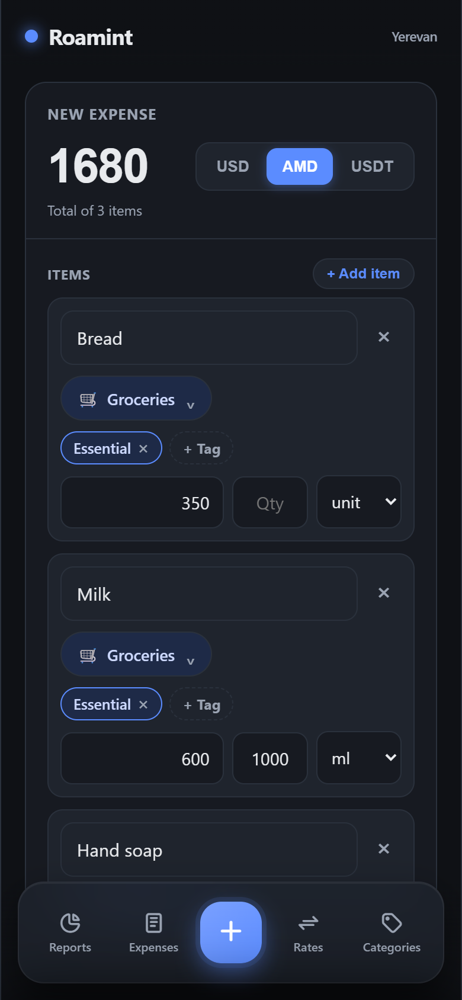
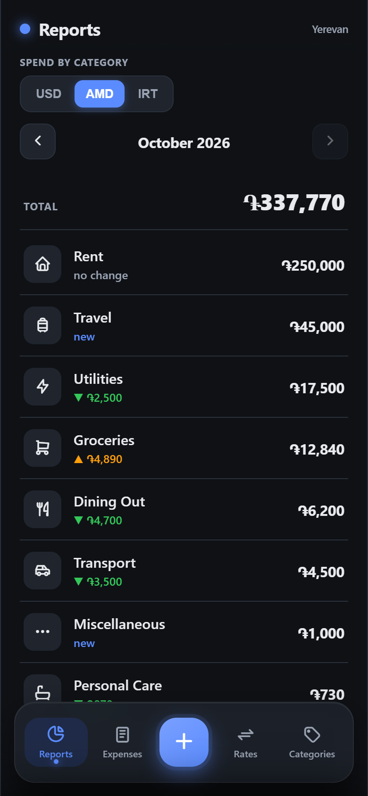
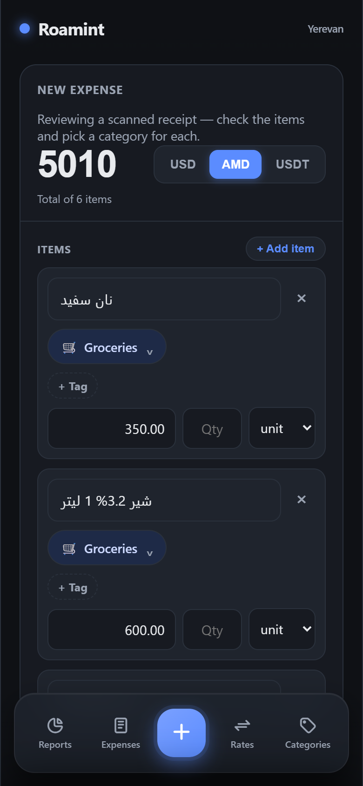

# Roamint

[](https://github.com/mohammadaminidev/Roamint/actions/workflows/ci.yml)

Personal multi-currency expense tracker for daily use by an expat in Armenia. Multi-currency by necessity (cash USD, cash AMD, USDT), single-tenant by design.

Also a portfolio piece — modular monolith on .NET 10 with .NET Aspire, Blazor Server, PostgreSQL + pgvector, OpenTelemetry, and DDD-style bounded contexts.

> **Privacy:** This repo is public. The real data is not. Seed values and screenshots use anonymized data. The schema is single-tenant and not hardened for multi-user.

## For reviewers

**What this project shows**

- **Modular monolith on .NET 10 + Aspire** — three bounded contexts (Expenses, Wallet, Receipts) deployed as one Blazor Server host; the AppHost orchestrates Postgres, PgAdmin, and the web app for local dev.
- **Schema per module** — each module owns a Postgres schema, `DbContext`, and migrations history; no cross-schema foreign keys; the host references only each module's `Contracts` project.
- **DDD-style bounded contexts** — aggregates with private setters and factory methods, strongly-typed IDs (`record struct` over `Guid.CreateVersion7()`), value objects (`Money`, `CurrencyPair`), domain events captured to a transactional outbox, a hand-rolled CQS dispatcher, and vertical-slice use cases (one file per command/query + handler).
- **Tests against real Postgres** — 225 tests (xUnit v3 + Shouldly); persistence and read-model tests run against a throwaway `pgvector` container via Testcontainers.
- **OpenTelemetry** — logs, metrics, and traces exported over OTLP to the Aspire dashboard via a shared `ServiceDefaults` project.
- **LLM OCR behind Microsoft.Extensions.AI** — receipt photos go to Gemini 2.5 Flash through an `IChatClient` over an OpenAI-compatible endpoint; the provider is config-swappable and a stub takes over when no key is set.

**Three design records worth reading**

- [`0021` — Exact item matching](docs/features/0021-uncertain-item-matching.md): reversing an embedding-similarity design (0016) after it produced confident wrong matches on real receipts (lemon → carrot), and choosing exact-or-manual instead.
- [`0015` — Receipt OCR](docs/features/0015-receipts-ocr.md): picking a vision model under real constraints — a local 8 GB VLM read the numbers but not Armenian script; `gemini-2.0-flash` had a zero free-tier quota.
- [`0010` — Wallet exchange rates](docs/features/0010-wallet-rates.md): keeping FX out of the expense aggregate, a natural composite key (`CurrencyPair`), and USD-spoke triangulation for display conversion.

All 22 records are indexed in [`docs/README.md`](docs/README.md).

**Run it** (needs the .NET 10 SDK and Docker):

```powershell
dotnet run --project src/Hosting/Roamint.AppHost --launch-profile http
```

Open the dashboard link printed to stdout, then the `web` resource. Receipt OCR needs a Gemini key (`dotnet user-secrets set Ocr:ApiKey <key> --project src/Bootstrap/Roamint.Web`); without one, a stub returns an empty draft and the form is filled by hand.

**Run the tests** (Docker must be running for the Testcontainers suites):

```powershell
dotnet test
```

## Screenshots

<!-- Uncomment once the PNGs exist in docs/screenshots/ (see docs/screenshots/README.md).
| Add expense (mobile) | Monthly summary | Receipt OCR review |
|:---:|:---:|:---:|
|  |  |  |
-->

## Status

**In daily use.** Three modules are built — **Expenses**, **Wallet**, and **Receipts** — and a fourth, **Insights**, is planned. V1 is done except category management (deliberately postponed; a seed list plus SQL covers it for now). The V2 capture features — receipt OCR, item matching, clipboard order import, live camera over HTTPS, background processing, installable PWA — have shipped; natural-language queries and spreadsheet export are still open. Aspire AppHost orchestrates Postgres (`pgvector/pgvector:pg17`), PgAdmin, and the Blazor Server host.

See [`docs/features/`](docs/features) for the per-slice design records (`0001`–`0022`).

### V1 — replace the Excel workflow

- [x] Solution scaffold
- [x] Expenses module — domain (Expense, Category) with strongly-typed IDs, EF Core persistence, domain events captured to a transactional outbox table (no drain yet — see Architecture)
- [x] Add-expense form — mobile-first, one-handed thumb input; per-item categories + optional quantities (g/ml/Pcs), derived total, item autocomplete carrying category + unit + tags, category suggestion, duplicate-guard confirmation on a same-day/-currency/-total twin (0022)
- [x] Tags — scoped (per-category) + global classification axis; managed vocabulary with per-line picker and inline create
- [x] Exchange rates — `Exchange` + `ExchangeRate` aggregates; USD-triangulated display conversion; manual override
- [x] Expense list — date-range / category filters; display-denomination conversion ("All" = originals) with missing-rate routing to the rate page
- [x] Monthly summary — reports home (`/`) with per-category totals in AMD / USD / IRT (toman), prior-month delta, and missing-rate routing to the rate page
- [ ] Category management — create, rename, archive, merge (no destructive delete). Create / rename / archive exist in the domain and write API; merge and the UI are postponed until a seed list + SQL stops being enough.

### V2 — capture done, insights open

- [x] Receipt photo OCR (Receipts module) — photograph a receipt, OCR extracts
  items/prices via Gemini 2.5 Flash (reads Armenian), review + assign categories in the
  add-expense form, link to the recorded expense. Config-driven provider over an
  OpenAI-compatible endpoint; stub fallback when no key. See `docs/features/0015`.
- [x] Receipt item matching (Expenses) — receipt items are translated to Farsi; a confirmed
  rename is learned, so the next receipt with the same item text resolves it (name + unit +
  category) automatically. Shipped first as embedding similarity (local `bge-m3` + pgvector,
  `docs/features/0016`), then replaced by **exact normalised matching** after real receipts
  produced confident false positives (`docs/features/0021`). Embeddings are still stored for
  Insights but nothing reads them.
- [x] Clipboard order import (Receipts module) — paste a Yerevan City order's JSON, a
  source-agnostic parser registry maps it to the same review draft as OCR, reusing item
  matching + learn-on-confirm. Dedup on `(source, external id)`. See `docs/features/0017`.
- [x] Live camera over HTTPS — Tailscale-issued certificate so the phone gets a secure
  context for `getUserMedia`; token-capped capture. See `docs/features/0018`.
- [x] Background receipt processing — OCR + matching run in a hosted worker with a live
  notification bar instead of blocking the Blazor circuit. See `docs/features/0019`.
- [x] Installable PWA — home-screen install and an offline notice (not offline-capable).
  See `docs/features/0020`.
- [ ] Natural-language queries over expenses (**Insights module — planned, not started**;
  no project under `src/Modules/` yet). The feature that motivates the outbox drain.
- [ ] Spreadsheet export (import landed dev-only in 0013).

### V3+ — later

- Wallet balances — de-emphasized; per-currency balances from exchanges + expenses (builds the outbox drain)
- Anomaly / budget alerts
- FIFO cost basis for crypto wallets

## Quick start

Requires .NET 10 SDK and Docker.

```powershell
dotnet run --project src/Hosting/Roamint.AppHost --launch-profile http
```

The Aspire dashboard URL appears in stdout (e.g. `http://localhost:15043/login?t=...`). Open it to see Postgres, PgAdmin, and the Web host with live state, logs, and OpenTelemetry traces.

First run pulls `pgvector/pgvector:pg17` and `dpage/pgadmin4`. Postgres data persists in the `roamint-pgdata` Docker volume across AppHost restarts.

## Tech stack

| Layer                | Choice                                                       |
|----------------------|--------------------------------------------------------------|
| Runtime              | .NET 10, C# 14                                               |
| Web UI               | Blazor Server (`Roamint.Web`)                                |
| Orchestration (dev)  | .NET Aspire 13.4 (AppHost SDK 13.3.2)                        |
| Database             | PostgreSQL 17 + `pgvector`                                   |
| ORM                  | EF Core 10 (writes + no-tracking read models; Dapper planned for analytics) |
| Tests                | xUnit v3 (Microsoft.Testing.Platform), Shouldly, Testcontainers.PostgreSql |
| Telemetry            | OpenTelemetry (logs, metrics, traces via OTLP)               |
| LLM abstraction      | Microsoft.Extensions.AI over an OpenAI-compatible endpoint (Gemini 2.5 Flash for OCR) |
| Dispatcher           | Hand-rolled in-process; no MediatR                           |

## Architecture

Modular monolith with three bounded contexts built — Expenses, Wallet, Receipts — and Insights planned. Each module owns its schema (`expenses.`, `wallet.`, `receipts.`) in one Postgres database, with its own `DbContext` and migrations history; no foreign keys cross schemas (a receipt references its expense by plain ID). Inside each module: Domain → Application → Infrastructure → Contracts, and the web host references only `Contracts`.

**What exists today:** each module's `DbContext` captures its aggregates' domain events into that module's `outbox_messages` table during `SaveChanges`, in the same transaction as the state change. Nothing reads that table yet — there is no outbox processor and no cross-module subscriber. Workflows that span modules (e.g. confirm a receipt → record the expense → link the receipt) are composed in the Blazor host, which calls each module's public `Contracts` API in turn. The hand-rolled dispatcher (`0003`) already routes in-process integration events to handlers, but nothing publishes any.

**Planned:** an outbox processor that drains each module's table, maps domain events to integration events, and publishes them through that dispatcher. It lands with its first real consumer (Insights or Wallet balances), not before.

## Docs

- [`docs/`](docs) — feature designs, decisions, and architecture notes (`docs/features/<NNNN>-<slug>.md`).
- [`CLAUDE.md`](CLAUDE.md) — operating instructions for Claude Code working in this repo.

## Hosting & cost

- Local dev: Aspire AppHost + Docker.
- Target production: containerized .NET app on Render free tier + Neon Postgres free tier. Target running cost: $0/month, with the option to upgrade to ~$5/month if cold starts get annoying.

## License

[MIT](LICENSE) © 2026 Mohammad Amini.
